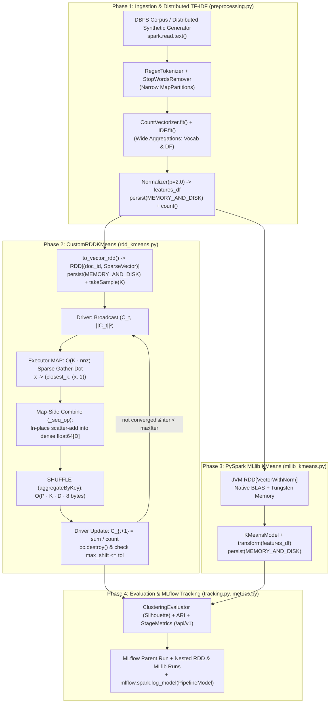

# Distributed Document Clustering & K-Means Benchmark (RDD vs PySpark MLlib)

Production-grade Big Data engineering benchmark comparing a **from-scratch MapReduce K-Means** built strictly on PySpark RDD transformations and actions ([`CustomRDDKMeans`](src/kmeans_benchmark/rdd_kmeans.py)) against the **Catalyst / Tungsten / BLAS-optimized [`pyspark.ml.clustering.KMeans`](src/kmeans_benchmark/mllib_kmeans.py)** DataFrame API on high-dimensional sparse TF-IDF document vectors, tracked end-to-end with **MLflow** on **Databricks**.

---

## 1. Repository Structure

```text
ProjetBigData/
├── pyproject.toml                         # Package metadata & CLI entry-point (`kmeans-benchmark`)
├── README.md                              # Architecture, Spark DAG analysis & usage guide
├── notebooks/
│   └── kmeans_benchmark_driver.py         # Databricks Notebook source (# COMMAND ---------- cells)
├── src/
│   └── kmeans_benchmark/
│       ├── __init__.py                    # Public configuration exports
│       ├── config.py                      # Immutable dataclasses (DataConfig, FeatureConfig, KMeansParams, TrackingConfig)
│       ├── spark_session.py               # Databricks/local SparkSession builder & executor zip shipping
│       ├── ingestion.py                   # Phase 1a: DBFS spark.read.text loader + executor-side synthetic generator
│       ├── preprocessing.py               # Phase 1b: RegexTokenizer -> StopWordsRemover -> CountVectorizer -> IDF -> L2 Normalizer
│       ├── vector_ops.py                  # Vectorized sparse-aware NumPy kernels (O(K * nnz) gather-dot, scatter-add)
│       ├── rdd_kmeans.py                  # Phase 2: CustomRDDKMeans & RDDKMeansModel (broadcast, map, aggregateByKey)
│       ├── mllib_kmeans.py                # Phase 3: pyspark.ml.clustering.KMeans wrapper with matched hyperparameters
│       ├── metrics.py                     # Spark Monitoring REST API (/api/v1) stage shuffle read/write collector
│       ├── evaluation.py                  # ClusteringEvaluator Silhouette, cluster sizes, ARI, top centroid terms
│       ├── tracking.py                    # Phase 4: MLflow parent/nested run logging & mlflow.spark.log_model
│       └── benchmark.py                   # End-to-end orchestrator & CLI
└── tests/
    ├── conftest.py                        # Session-scoped local Spark fixture
    ├── test_vector_ops.py                 # Fast Spark-free unit tests for sparse NumPy kernels & ARI
    └── test_spark_integration.py          # Spark integration tests (NumPy Lloyd parity, cosine, end-to-end MLflow)
```

---

## 2. System Architecture & Spark DAG Analysis



### Computational & Shuffle Complexity Breakdown

| Stage / Operation | Time Complexity (per iter) | Network / Shuffle Volume (per iter) | Key Optimization in This Codebase |
| :--- | :--- | :--- | :--- |
| **Centroid Broadcast** | $O(K \cdot D)$ on driver | $\approx K \cdot D \cdot 8\text{ B}$ (TorrentBroadcast) | Pre-computes $\|c_k\|^2$ on the driver and broadcasts `(centers, sq_norms)`; explicitly calls `bc.destroy()` at the end of every iteration. |
| **Map Phase (Nearest Centroid)** | $O(N \cdot K \cdot \text{nnz})$ | $0\text{ B}$ (embarrassingly parallel) | Uses $\|x - c_k\|^2 = \|x\|^2 - 2 x^\top c_k + \|c_k\|^2$ with sparse column gather `centers[:, x.indices] @ x.values` instead of densifying $x$. |
| **Map-Side Combine (`_seq_op`)** | $O(N \cdot \text{nnz})$ | $0\text{ B}$ (partition-local) | Accumulates sparse vectors directly into a single partition-local dense `float64[D]` array via `acc[x.indices] += x.values`, avoiding $O(N \cdot D)$ intermediate `SparseVector` allocations. |
| **Shuffle & Reduce (`aggregateByKey`)** | $O(P \cdot K \cdot D)$ | $\le P \cdot K \cdot D \cdot 8\text{ B}$ | Bounded by number of partitions $P$ and clusters $K$ — **independent of corpus size $N$**. Sets `numPartitions = min(K, defaultParallelism)`. |
| **Convergence & Lineage** | $O(K \cdot D)$ on driver | $K \cdot D \cdot 8\text{ B}$ (`collectAsMap`) | Each iteration starts from the cached `vectors` RDD and materializes `collectAsMap()` to the driver, breaking RDD lineage each step (no checkpointing needed). |

### Why MLlib Outperforms Python RDD K-Means (~10x Speedup)
Even when the Python RDD implementation uses optimal sparse NumPy kernels and map-side combining:
1. **JVM $\leftrightarrow$ Python Serialization Overhead:** Every RDD iteration streams pickled `SparseVector` objects from the JVM BlockManager over loopback sockets to Python worker processes, and pickles partial dense `float64[D]` arrays back to the JVM for the shuffle. MLlib keeps `RDD[VectorWithNorm]` inside the JVM heap.
2. **Precomputed Point Norms (`VectorWithNorm`):** MLlib caches $\|x\|_2$ alongside each vector once before iteration 1, whereas the RDD map phase computes `np.dot(x.values, x.values)` per document per iteration.
3. **Native BLAS & Thread-Level Parallelism:** MLlib's Scala engine shares one broadcasted centroid matrix across all task threads in an executor JVM without multi-process duplication.

---

## 3. Running the Project

### A. On Databricks Runtime (Recommended: DBR 14.3 LTS ML / 15.4 LTS ML)
> **Cluster Access Mode Requirement:** Phase 2 uses `spark.sparkContext`, `RDD`, `broadcast`, and `accumulator`. Use a cluster in **Dedicated (Single-user)** access mode (or No-isolation shared). Serverless and Standard/shared UC clusters restrict the low-level RDD API.

1. Import this repository into **Databricks Git Folders (Repos)**.
2. Open [`notebooks/kmeans_benchmark_driver.py`](notebooks/kmeans_benchmark_driver.py).
3. Configure the notebook widgets at the top:
   - `input_path`: e.g. `dbfs:/FileStore/kmeans_benchmark/synthetic_corpus` (or an existing DBFS / Unity Catalog Volume path)
   - `num_docs`: `200000` (generated on executors if `input_path` is missing)
   - `k`: `8`
   - `max_iter`: `20`
   - `tol`: `1e-4`
   - `distance`: `euclidean` or `cosine`
   - `vocab_size`: `16384`
4. Run all cells. Inspect the MLflow experiment at `/Users/<your-user>/kmeans_rdd_vs_mllib_benchmark` for nested runs, per-iteration convergence plots, shuffle metrics, and the logged `PipelineModel`.

### B. Local CLI & Pytest Suite

```powershell
# 1. Create virtual environment & install package with dev dependencies
uv venv .venv --python 3.12
uv pip install -e ".[dev]"

# 2. Run the full unit + Spark integration test suite
pytest -v

# 3. Run the CLI benchmark locally
python -m kmeans_benchmark.benchmark `
  --in-memory `
  --num-docs 5000 `
  --num-partitions 8 `
  --vocab-size 4096 `
  --k 8 `
  --max-iter 15 `
  --tol 1e-4 `
  --distance euclidean
```
*(Note: PySpark 3.5 requires Java 11 or Java 17 on `JAVA_HOME`.)*

---

## 4. Reference Benchmark Output (Spark 3.5.9)

| Metric | Custom RDD K-Means (`RDD`) | PySpark MLlib (`MLlib`) | Notes |
| :--- | ---: | ---: | :--- |
| **Total Execution Time (s)** | `36.150 s` | `3.642 s` | **9.93x speedup** for MLlib |
| **Silhouette Score** | `0.25115` | `0.24249` | Evaluated via `ClusteringEvaluator` |
| **ARI vs. Ground Truth** | `0.56538` | `0.54968` | 8 latent technical topics |
| **Shuffle Read Bytes** | `67,698 B` | `73,062 B` | Extracted from `/api/v1/.../stages` |
| **Shuffle Write Bytes** | `67,698 B` | `73,062 B` | Map-side combine bounds shuffle size |
| **Executor Run Time** | `60,162 ms` | `1,949 ms` | Reflects Python worker vs JVM execution |
